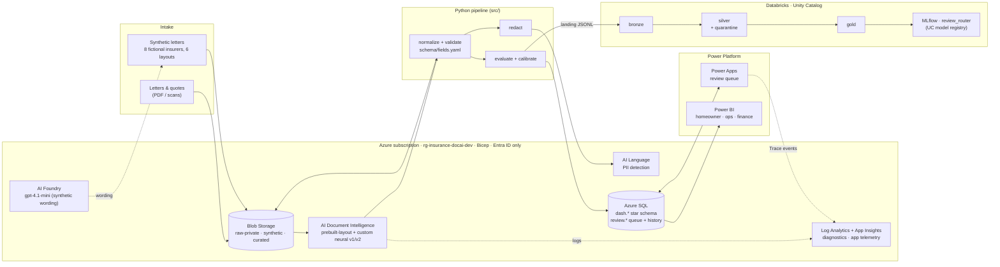
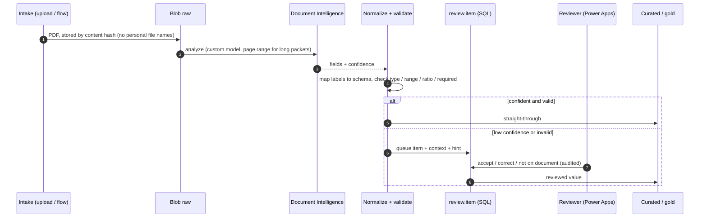
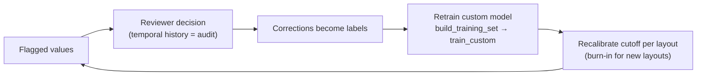
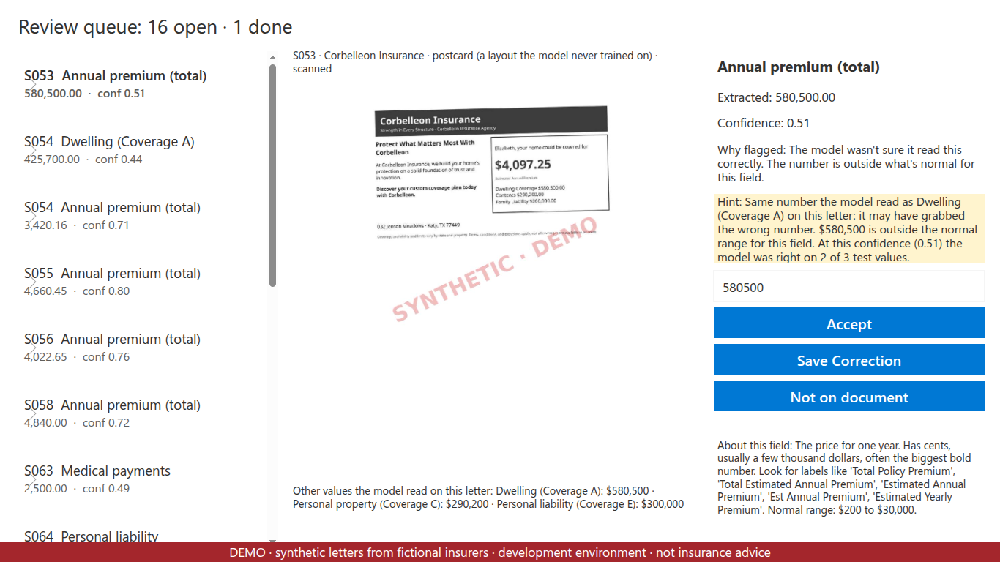
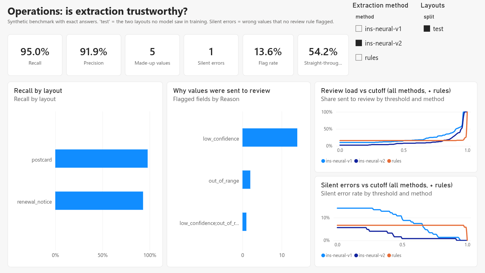
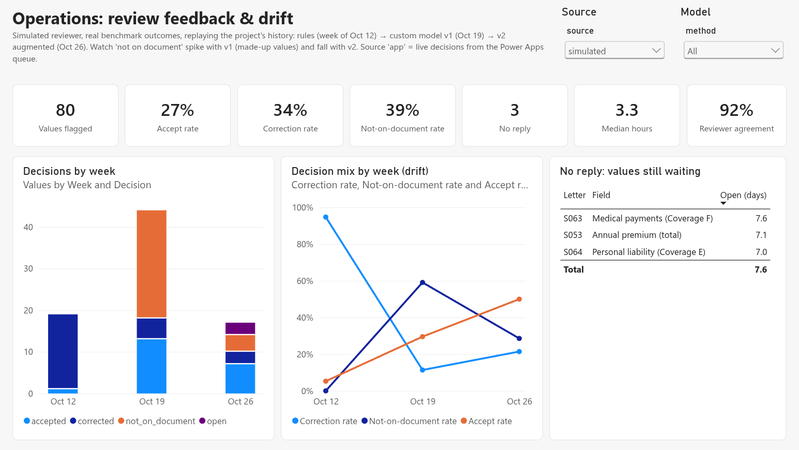
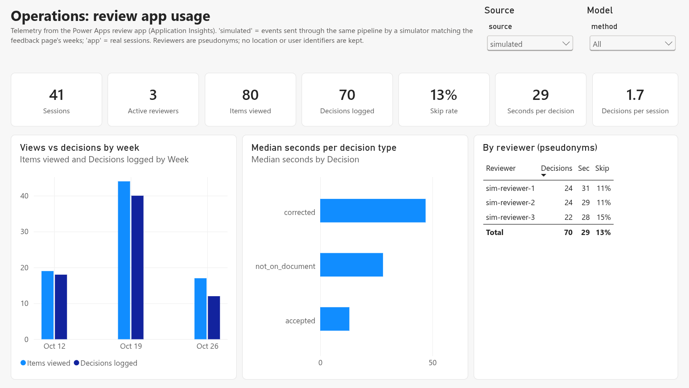
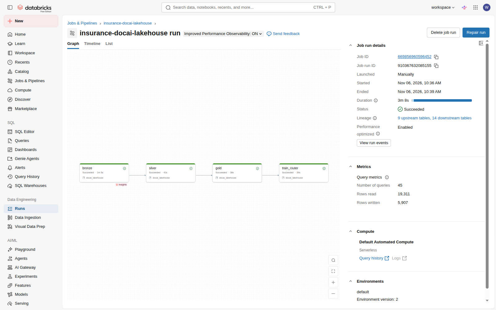
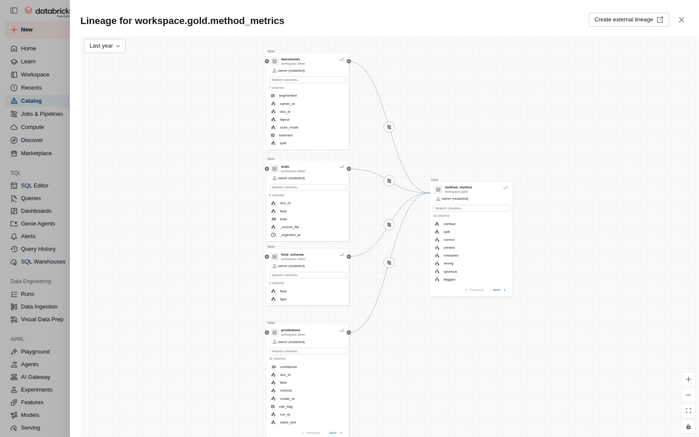

# insurance-docai: AI document processing with a human in the loop, on Azure

**Built for:** the *Project Analytics & Insights Engineer III* role on the AI & Data team
(Government & Public Services, requisition 373221). This repo shows the work that role describes, end to end:
*"design and develop AI enabled solutions to process unstructured data using … Azure AI Document Intelligence;
Power Platform Tools; Python; Databricks."* It is an independent portfolio project, not affiliated with or
endorsed by any employer or agency.

**The problem.** My home-insurance renewal came in at about **$7,200 a year**, while nine other insurers had
mailed "personalized quotes" for the same house at roughly **$1,000-3,000**. No two letters used the same
layout or wording, two had my square footage wrong, and only one printed a wind/hail deductible. Comparing
them meant pulling the same dozen numbers out of every letter and deciding which ones could be trusted.

That is a small instance of a common government and financial-services problem: documents arrive in many
formats, and the organization needs structured data it can trust, with a person reviewing whatever the
machine is unsure about, and an audit trail. ([docs/PROBLEM.md](docs/PROBLEM.md))

**Status (2026-11-06):** extraction, evaluation, review app, lakehouse and dashboard are built, tested and
deployed in a development setup. Public write-up: [docs/REPORT.md](docs/REPORT.md).

---

## How this maps to requisition 373221

| The role asks for | What is in this repo | Where |
| :--- | :--- | :--- |
| Process **unstructured data** with **Azure AI Document Intelligence** | Prebuilt layout baseline, two **custom neural extraction models** trained from auto-generated labels, per-field confidence, page-range control for long packets | `src/run_layout.py`, `src/build_training_set.py`, `src/train_custom.py` |
| **AI Model Build** (4+ yrs) | Custom extraction models (v1 → v2 with data augmentation: precision 76% → 92%), confidence calibration, a gradient-boosting **review router** with leave-one-carrier-out validation, MLflow + Unity Catalog model registry | `docs/RESULTS.md`, `databricks/src/docai_lakehouse/router.py` |
| **Power Platform** (4+ yrs) | **Power Apps** review queue (canvas app on Azure SQL, Entra ID connection) kept **as code**: unpacked sources in git, `pac` CLI pull/push through a Dataverse solution. **Power BI** report (3 pages) generated as code (PBIR) | `powerapps/`, `src/build_report.py`, `docs/POWERAPPS.md` |
| **Azure Data Engineering, Intelligence and Analytics** (4+ yrs) | Bicep infrastructure, Blob raw/curated zones, Azure SQL serving layer, Log Analytics, budgets and tag governance, CI (GitHub Actions) | `infra/`, `tools/`, `.github/workflows/` |
| **Databricks** (preferred) | Asset bundle: **Unity Catalog medallion** (bronze → silver with quarantine and a quality gate → gold), wheel tasks, MLflow, serverless / job clusters only. Deployed and run | `databricks/` |
| **Azure SQL Server** (preferred) | Entra-only Azure SQL: dashboard star schema, review queue with **temporal-table audit history**, least-privilege column grants | `src/load_sql.py`, `src/review_queue.py` |
| **Python** | All pipeline, evaluation, synthetic-data and publishing code, with tests | `src/`, `tests/` |
| **Financial services** (insurance, mortgage) | Homeowners policies, premiums, coverages A-F, deductibles, mortgagee requirements, TDI regulatory context | `schema/fields.yaml`, `docs/PROBLEM.md` |
| Meticulous attention to quality | Held-out-layout benchmark with exact answers, silent-error metric, an honest threshold check that **overturned** an optimistic result, a negative result reported as such | `docs/RESULTS.md` Phases 3b, 4a |
| Public Trust-style handling of sensitive data | Real letters never leave `private/`; three-layer PII redaction with measured misses; synthetic stand-ins for every public artifact; no keys or passwords anywhere | `docs/PRIVACY.md`, `src/redact.py` |
| Clear written guidance for others | Runbook, known-issues table, step-by-step build guides, this README | `docs/RUNBOOK.md`, `docs/POWERAPPS.md` |

**Production design:** [docs/ARCHITECTURE.md](docs/ARCHITECTURE.md) is the Azure **reference architecture** for running this
inside a client's closed network: private endpoints only, Azure Databricks Premium with Unity Catalog,
Power BI / Fabric capacity behind a VNet data gateway, Power Platform managed environments with VNet support.

---

## Results in one table

| | Finding |
| :--- | :--- |
| OCR confidence alone | Useless for routing on unfamiliar layouts: wrong values scored as high as right ones (AUC 0.53) |
| Custom model vs rules on **unseen layouts** | Fields extracted correctly: 78% → 93% (v1) → **95% (v2)**; made-up values 30 → **5** after augmentation |
| Review threshold | Looked like 6.5% review at ≤2% silent errors; **cross-checked across layouts it didn't hold** (9% silent on the harder layout) → new layouts need a burn-in review period |
| Review router (Databricks) | Ranks errors far better than confidence (AUC 0.91-0.95), but doesn't beat threshold + validity rules at equal budget with 8 insurers. Reported as a negative result |
| Real letters (provisional) | ~97% of printed fields correct, no silent errors |
| Privacy | Generic PII service missed policy and loan numbers; domain rules caught the rest |
| Review app | Accept / correct / not-on-document tested end to end; 3/3 decisions scored correct against a hidden answer key |
| Review app telemetry | Application Insights events per view/decision: corrections take ~3× longer than accepts; skip rate and per-reviewer throughput (pseudonyms) |
| Review feedback as drift monitor | Replaying the project's history: "not on document" jumps 0% → 59% when the first custom model ships (made-up values), falls to 29% after augmentation; no-reply aging shows review backlog |

Details: [docs/RESULTS.md](docs/RESULTS.md). Narrative: [docs/REPORT.md](docs/REPORT.md).

---

## Architecture as built (development)



Dev choices (each one has a production counterpart in [docs/ARCHITECTURE.md](docs/ARCHITECTURE.md)):
public endpoints protected by Entra ID only (no keys, no SQL passwords); Databricks **Free Edition** (Azure
Databricks needs a pay-as-you-go subscription to attach Unity Catalog); Power BI **push dataset** (no Desktop on
Linux) and Power Apps **Developer Plan**.

---

## Workflows

### 1. Document → trusted data (per document)



### 2. Human review → better models (the improvement loop)



### 3. Model build and evaluation (synthetic benchmark with exact answers)

`synth/kits.py` (fictional insurer wording via Foundry) → `synth/generate.py` (96 letters + 150 "bad" augmented
letters, every value planted) → `synth_layout.py` → `build_training_set.py` → `train_custom.py` →
`eval_extraction.py` (held-out layouts only) → `calibrate.py` (threshold sweep + cross-layout check).

### 4. Analytics refresh

`build_dashboard_tables.py` → `build_review_feedback.py` (review decisions → feedback/drift table) → `pull_app_telemetry.py` (Application Insights → usage table) → `load_sql.py` (Azure SQL `dash`) → `publish_powerbi.py` (semantic model,
reports rebound on schema change) → `build_report.py` (report pages as code). Lakehouse:
`export_landing.py` → `databricks bundle deploy/run` (bronze → silver → gold → router).

### 5. Release (everything as code)

| Asset | Source of truth | Deploy |
| :--- | :--- | :--- |
| Azure resources | `infra/main.bicep` | `infra/up.sh` |
| Lakehouse jobs, schemas, volume | `databricks/databricks.yml` | `databricks bundle deploy -t free` |
| Power BI report | `powerbi/report/` (PBIR) | `src/build_report.py` |
| Power Apps review app | `powerapps/src/` (unpacked canvas app) | `powerapps/deploy.sh push` (Dataverse solution import) |
| Review queue schema + grants | `src/review_queue.py` | `src/review_queue.py --reviewer <upn>` |
| Tests | `tests/`, `databricks/tests/` | GitHub Actions (`.github/workflows/ci.yml`) |

---

## Screens

| Review app (Power Apps) | Operations dashboard (Power BI) |
| :--- | :--- |
|  |  |

| Review feedback & drift (Power BI) | Review app usage (Application Insights → Power BI) |
| :--- | :--- |
|  |  |

| Databricks job run (bronze → silver → gold → router) | Unity Catalog lineage into `gold.method_metrics` |
| :--- | :--- |
|  |  |

All screens use synthetic letters from fictional insurers and a simulated household; account names are redacted.

---

## Repo map

| Path | What |
| :--- | :--- |
| `infra/` | Bicep (resources, tags, RBAC), `up.sh` / `down.sh`, subscription tag policy (`governance.sh`) |
| `schema/fields.yaml` | The one schema: fields, label synonyms, ranges, ratios, required-by-doc-type |
| `src/` | Pipeline, synthetic data (`synth/`), evaluation, calibration, redaction, SQL / Power BI / review-queue publishing |
| `databricks/` | Asset bundle, medallion transforms, review router, local Spark tests |
| `powerapps/` | Review app sources + `deploy.sh` (pull / push) |
| `powerbi/` | Report definition (PBIR) + backups |
| `docs/` | Report, results, architecture, runbook, privacy, review, build guides |
| `tools/` | FinOps (tags, budgets, month-to-date cost), template tag check |

## Run it

No real letters needed: the synthetic corpus, its answers, its extraction output and the evaluation results are
all in the repo. **[docs/QUICKSTART.md](docs/QUICKSTART.md)** has three depths: laptop only ($0), Azure (a free
trial works), and the full stack (Power BI, Power Apps, Databricks Free Edition).

```bash
python3 -m venv .venv && .venv/bin/pip install -r requirements.txt
.venv/bin/pytest -q tests                    # unit tests, no cloud
az login && infra/up.sh                      # Azure resources (idempotent), writes .env
```
Operating everything: [docs/RUNBOOK.md](docs/RUNBOOK.md). Idle cost is about $0 (free tiers, auto-pausing
SQL, pay-per-use AI services, capped logging).

## Privacy

The author's real letters never appear in this repo; public results from them are aggregates and rounded
figures only. Every screenshot and sample uses synthetic data. See [docs/PRIVACY.md](docs/PRIVACY.md).

## Coming from AWS? Azure cheat-sheet

| Azure | Closest AWS idea | Notes |
| :--- | :--- | :--- |
| Tenant (Microsoft Entra ID) | AWS Organization + IAM Identity Center | The identity directory; users and apps live here |
| Subscription | AWS account | Billing + quota boundary; holds resource groups |
| Resource group | CloudFormation stack / a tag scope | Deleting the group deletes everything in it |
| Role-based access control (RBAC) | IAM policy attachment | Assigned at subscription / group / resource scope |
| Managed identity | IAM role for a service | Lets an app call other Azure services without secrets |
| Blob Storage / ADLS Gen2 | S3 | A storage account can hold many containers |
| AI Document Intelligence | Textract | Prebuilt + custom-trained document models, per-field confidence |
| AI Language | Comprehend | Includes PII detection and redaction |
| Azure OpenAI / AI Foundry | Bedrock | Hosted LLMs |
| Azure Databricks | Databricks on AWS / EMR | Unity Catalog governs data + models |
| Azure SQL Database | RDS for SQL Server | Has a free offer |
| Private endpoint | VPC interface endpoint (PrivateLink) | Service reachable only on a private IP |
| Bicep / ARM templates | CloudFormation | Bicep compiles to ARM JSON |
| Power Platform (Apps, Automate, BI) | (no direct equivalent) | Separate admin portal from Azure |
