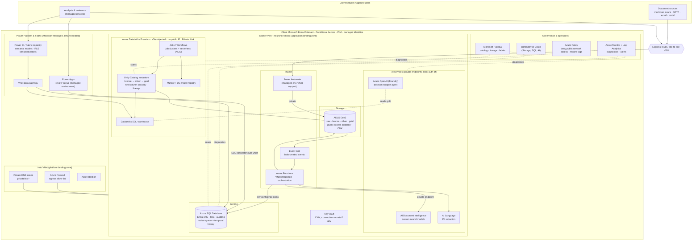
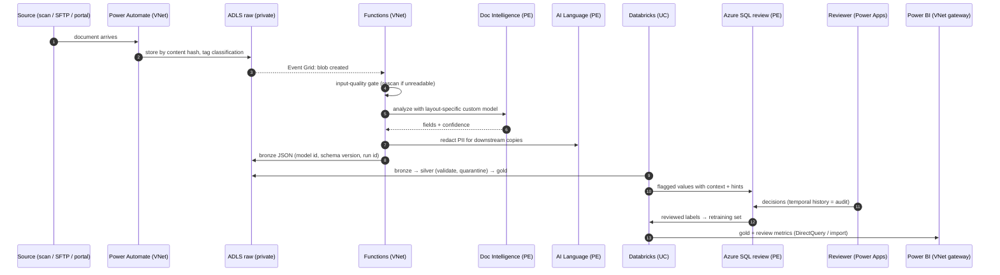

# Azure reference architecture: document AI with human review in a closed network

**Audience:** the AI & Data team hiring for *Project Analytics & Insights Engineer III* (req 373221), and anyone
taking this pattern to a government or financial-services client.

**What "closed" means here:** no service is reachable from the public internet. Every data path stays on
private IPs inside the client's Azure landing zone (or comes in over ExpressRoute / VPN from the client network);
identity is the client's Entra ID tenant; nothing uses keys or passwords. This is the production counterpart of the
development build in this repo (which used public endpoints protected by Entra ID, Databricks Free Edition, a
Power BI push dataset and a Power Apps Developer Plan).

Not deployed: this is the target design. Each component is something the dev build already exercises, so the
move is configuration and networking, not a rewrite (see [the mapping table](#from-this-repo-to-production)).

---

## 1. Overview

---

## 2. Components and why each is configured this way

| Layer | Service (production SKU) | Closed-network configuration | Why |
| :--- | :--- | :--- | :--- |
| Identity | Microsoft Entra ID (client tenant) | Conditional Access (compliant device, MFA), PIM for admin roles, groups for RBAC, **managed identities** for every service-to-service call, workload identity federation (OIDC) for CI/CD | No keys or passwords exist to leak; access is reviewable per group |
| Network | Hub-spoke VNets, Azure Firewall, Private DNS, Bastion, ExpressRoute/VPN | Every PaaS service has `publicNetworkAccess: Disabled` + a **private endpoint** in the spoke; egress only through the firewall allow-list | Data never crosses the internet; one place to audit egress |
| Intake | Power Automate (managed environment with **VNet support**) or Logic Apps Standard (VNet-integrated); Event Grid; Azure Functions Premium (VNet integration) | Flows run on the delegated subnet; Functions reach storage/AI over private endpoints | Low-code intake for business users, code for the heavy path, same network boundary |
| Storage | ADLS Gen2 (hierarchical namespace) | Private endpoints (blob + dfs), shared-key access off, customer-managed key in Key Vault, soft delete + versioning, immutability on `raw` if records rules require | Raw documents are records; the lake is also the Unity Catalog storage |
| Extraction | AI Document Intelligence S0, custom neural models | `disableLocalAuth`, private endpoint, managed identity reads training data from ADLS | Same models as dev; training data never leaves the lake |
| PII | AI Language (PII) + domain rules | Private endpoint, local auth off | Generic PII models miss domain IDs (measured in this project); rules close the gap |
| LLM (optional) | Azure OpenAI in AI Foundry | Private endpoint, no public network, content filters, prompt/response logging to Log Analytics | Decision-support agent over **gold** data only; never over raw PII |
| Lakehouse | **Azure Databricks Premium** | VNet injection, **secure cluster connectivity (no public IP)**, front-end + back-end **Private Link**, Unity Catalog with an access connector (managed identity) to ADLS, cluster policies (job clusters, auto-termination), serverless via network connectivity config | Medallion with governed lineage, row/column security and a model registry in one catalog |
| Serving | Azure SQL Database (General Purpose or Business Critical) | Entra-only auth, private endpoint, TDE (CMK), auditing to Log Analytics, Defender for SQL, temporal tables for review history | Transactional store for the review app; audit history built into the table |
| Review app | Power Apps (premium licenses), **managed environment** | VNet support so the SQL connector goes through the delegated subnet; DLP policy blocks non-business connectors; solutions + **pipelines** (dev → test → prod) | The human-in-the-loop step, governed like code |
| BI | Power BI Premium / **Fabric capacity** (F SKU) | **VNet data gateway** to SQL and Databricks SQL over private endpoints; RLS by agency/role; Purview sensitivity labels; tenant setting to restrict export | Import / DirectQuery semantic models with scheduled refresh (replaces the dev push dataset) |
| Secrets | Key Vault (Premium for HSM keys) | Private endpoint, RBAC mode, purge protection | Holds CMKs; ideally no application secrets at all |
| App telemetry | Application Insights (workspace-based) | Power Apps sends `Trace()` events with the connection string; ingestion over **Azure Monitor Private Link Scope (AMPLS)**; IP masking on | Review-tool usage (views, skips, seconds per decision) next to model metrics |
| Operations | Azure Monitor, Log Analytics, Workbooks, alerts | Diagnostic settings on every resource; alerts on review-rate drift, quarantine rate, job failures, budget | Drift and data quality are watched without labels (review rate, confidence distribution) |
| Security posture | Defender for Cloud | Plans for Storage, SQL, App Service/Functions, AI | Threat detection on the data plane |
| Policy | Azure Policy | Deny public network access, require private endpoints, require tags (cost center, data classification), allowed regions | Guardrails that hold even when someone clicks in the portal |
| Governance | Microsoft Purview | Scans Unity Catalog and SQL; lineage from raw document to dashboard; sensitivity labels flow to Power BI | One answer to "where did this number come from?" |
| CI/CD | GitHub Actions or Azure DevOps | OIDC federated credentials (no stored secrets); Bicep `what-if` gate; `databricks bundle deploy`; `pac solution import` via Power Platform pipelines; environment approvals | Every asset in this repo already has a deploy command |

---

## 3. Data flow (production)

---

## 4. Environments and release

| Environment | Azure | Databricks | Power Platform | Data |
| :--- | :--- | :--- | :--- | :--- |
| Dev | Spoke subscription `dev` | Workspace `dev`, own catalog | Developer / sandbox managed environment | Synthetic only |
| Test | `test` | Workspace `test` | Sandbox managed environment | Synthetic + masked samples |
| Prod | `prod` | Workspace `prod`, prod catalog, restricted groups | Production managed environment | Real documents |

Implemented as a mechanism (only dev is deployed): [ENVIRONMENTS.md](ENVIRONMENTS.md). Promotion is the same command per asset in every environment (Bicep → `az deployment`, bundles →
`databricks bundle deploy -t <env>`, Power Apps → solution import through a Power Platform pipeline, Power BI →
deployment pipeline or PBIR via the Fabric API), gated by tests and an approval.

---

## 5. Government and regulated-industry notes

- **Clouds:** federal workloads may require Azure Government and Power Platform / Power BI in GCC or GCC High.
  Service and feature availability differs from commercial Azure (custom models, model versions, serverless
  options); verify each service in the target cloud before committing a design.
- **Personnel and data handling:** least privilege by group, PIM for elevation, reviewer actions attributed to
  named Entra identities (the temporal history records each decision), and synthetic data in non-production.
- **Records:** raw documents kept immutable for the retention period; derived data reproducible from raw +
  model version + schema version (model id and run id are recorded per row in bronze today; schema version is planned).
- **Model risk:** held-out-layout evaluation, calibrated thresholds with a burn-in period for new layouts, drift
  alerts on review rate, and a documented human decision on every flagged value.

---

## 6. Cost shape (order of magnitude, verify with the Azure pricing calculator)

| Driver | Scales with | Note |
| :--- | :--- | :--- |
| Document Intelligence | Pages analyzed | Custom extraction ≈ $30 per 1,000 pages (S0, commercial list price); split long packets to the useful pages |
| Databricks | DBUs while jobs run | Job clusters and serverless only; no idle all-purpose clusters |
| Fabric / Power BI capacity | Capacity size, hours | The largest fixed cost; pause non-prod capacities |
| Private networking | Endpoints, firewall, gateway | Fixed monthly floor (firewall and private endpoints bill hourly) |
| Power Apps | Users | Premium per-user or per-app licensing for reviewers |
| SQL | vCores / serverless | Serverless auto-pause fits bursty review work |

---

## From this repo to production

| Concern | Development build (this repo) | Reference (production) |
| :--- | :--- | :--- |
| Network | Public endpoints, Entra ID only; SQL firewall allows Azure services | Private endpoints everywhere, public access disabled, hub firewall |
| Storage | Blob containers (`raw-private`, `curated`) | ADLS Gen2 + Unity Catalog external locations, CMK |
| Orchestration | Python scripts run by an operator | Event Grid + Functions / Power Automate, Databricks Workflows |
| Databricks | Free Edition (serverless), bundle target `free` | Azure Databricks Premium, VNet-injected, Private Link, bundle target per environment |
| Model registry | UC model `workspace.gold.review_router` | Same, in the prod catalog with approval to promote |
| Review app | Developer Plan, SQL connector over the public endpoint | Managed environment with VNet support, premium licenses, pipelines |
| Review audit | Temporal table `review.item_history` | Same, plus SQL auditing to Log Analytics |
| Usage telemetry | Application Insights over the public ingestion endpoint; simulator for demo traffic | Same events through AMPLS; alerts on skip rate and no-reply backlog |
| BI | Push dataset via REST + PBIR report via Fabric API | Fabric capacity, Import/DirectQuery semantic model through a VNet data gateway, RLS |
| Secrets | None (Entra ID + managed identity) | Same; Key Vault only for customer-managed keys |
| Governance | Tags, budgets, tag-check in CI, subscription tag policy (written) | Azure Policy initiative, Purview lineage, Defender for Cloud |
| Data | Synthetic + the author's own letters (private) | Client documents, classified and retained per records schedule |
