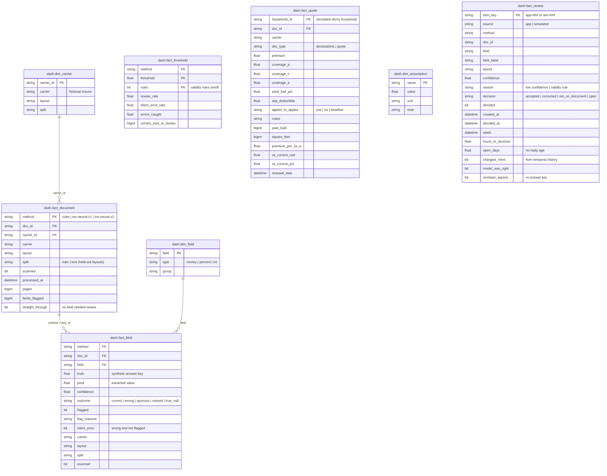
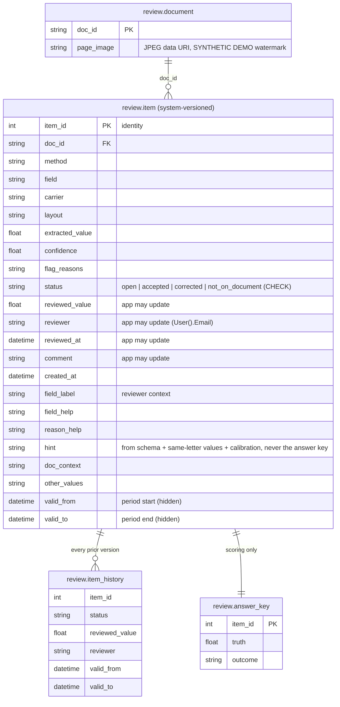
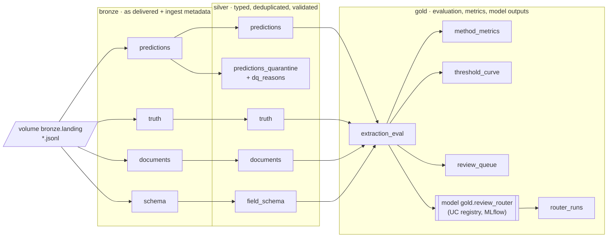
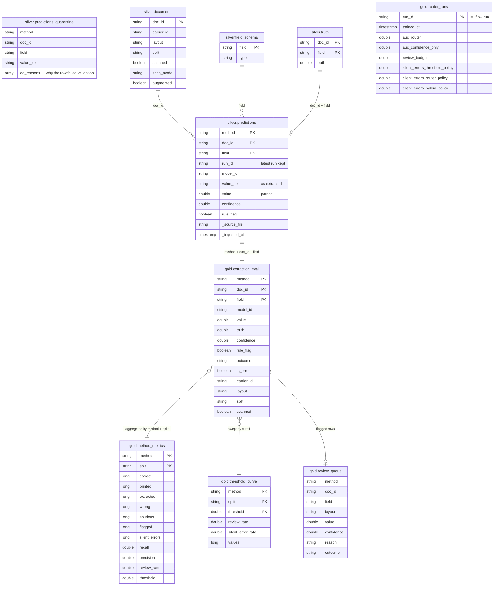

# Data model: Azure SQL and Databricks Unity Catalog

Two stores, two jobs:

- **Azure SQL Database** (`docai`) is the **serving** layer: a small star schema for Power BI (`dash`) and the
  transactional review queue the Power Apps app writes to (`review`).
- **Databricks Unity Catalog** (`workspace` catalog on Free Edition; one catalog per environment in production) is the
  **lakehouse**: raw landing files → validated data → evaluation and model outputs, in a bronze / silver / gold
  medallion.

Column lists below were read from the live databases on 2026-11-06 (`INFORMATION_SCHEMA` in both), not written
by hand. Keys are logical unless marked enforced: the `dash` tables are a full-refresh reporting copy, so
referential integrity is checked in the pipeline and modelled as relationships in Power BI.

---

## 1. Azure SQL: `dash` schema (Power BI star schema)

Loaded by `src/load_sql.py` from `data/dashboard/*.parquet` (full refresh each run). The Power BI semantic model
(`src/publish_powerbi.py`) adds a computed `doc_key = method | doc_id` on both fact tables to relate them.

| Table | Grain | Rows (2026-11-06) | Feeds |
| :--- | :--- | ---: | :--- |
| `fact_document` | method × document | 144 | Operations: straight-through rate, pages; Finance: cost, labor |
| `fact_field` | method × document × field | 1,043 | Operations: recall, precision, silent errors, flag reasons |
| `fact_threshold` | method × cutoff × rules on/off | 606 | Operations: review-load and silent-error curves |
| `fact_quote` | household × document | 9 | Homeowner page (simulated household only) |
| `fact_review` | value sent to a person | 97 | Review feedback & drift: decision, timing, no-reply age, agreement with answer key (`source` = app / simulated) |
| `dim_field` | field | 12 | Field names / groups |
| `dim_carrier` | carrier | 8 | Fictional insurers, layout, train/test split |
| `dim_assumption` | assumption | 6 | Unit prices and minutes behind the Finance measures |

DAX measures (Recall, Precision, Silent errors, Straight-through rate, Cost per document, Labor $ avoided, Current
premium, Best comparable quote, …) live in the semantic model, defined in `src/publish_powerbi.py`.

---

## 2. Azure SQL: `review` schema (Power Apps review queue)

Created by `src/review_queue.py`. This is the only part of the system a person writes to, so it carries the
controls: enforced primary keys, a status check constraint, a **system-versioned temporal table** for the audit
trail, and column-level grants.

| Table | Grain | Who can do what |
| :--- | :--- | :--- |
| `item` | one flagged value | Reviewer (work account): `SELECT`; `UPDATE` only on `status, reviewed_value, reviewer, reviewed_at, comment`. Operator: full |
| `item_history` | one superseded version of an item | Written by SQL Server itself; nobody edits it. `SELECT … FOR SYSTEM_TIME ALL` gives the full trail |
| `document` | one page image per document | Reviewer: `SELECT` |
| `answer_key` | one true value per item (synthetic) | **Operator only.** Lets `review_queue.py --score` grade reviewer decisions without showing the answer |

Why a temporal table and not a trigger: Power Apps' `Patch` sends `UPDATE … OUTPUT`, which SQL Server rejects on
tables with enabled triggers. System versioning records the same history with no trigger.

---

## 3. Databricks: Unity Catalog medallion

Built by the `docai_lakehouse` job (`databricks/`), all Delta tables, managed by Unity Catalog. Raw files land in
the volume `workspace.bronze.landing` (`src/export_landing.py` → `databricks fs cp`).

Quality gate: the silver task fails the job if more than 5% of prediction rows land in quarantine.

| Layer | Table | Grain | Notes |
| :--- | :--- | :--- | :--- |
| bronze | `predictions`, `truth`, `documents`, `schema` | as delivered | Every column kept, plus `_source_file`, `_ingested_at` |
| silver | `predictions` | method × document × field | Typed `value`, latest `run_id` only, rows failing checks moved out |
| silver | `predictions_quarantine` | rejected row | `dq_reasons` array: `missing_key`, `unknown_field`, `value_not_numeric`, `negative_value`, `confidence_out_of_range` |
| silver | `truth`, `documents`, `field_schema` | key per table | Typed, deduplicated |
| gold | `extraction_eval` | method × document × field | Prediction joined to truth and document facts; `outcome`, `is_error` |
| gold | `method_metrics` | method × split | Recall, precision, silent errors at the review cutoff (matches `docs/RESULTS.md`) |
| gold | `threshold_curve` | method × split × cutoff | Review load vs silent errors |
| gold | `review_queue` | flagged value | What would go to a person |
| gold | `router_runs` | training run | Review-router cross-validation results, linked to the MLflow run |
| model | `gold.review_router` | version | Registered in Unity Catalog (v1 on 2026-11-06) |

**Lineage across stores.** Bronze rows carry `model_id` and `run_id`, so any gold metric or Power BI number traces
back to the extraction run that produced it. In the production design ([ARCHITECTURE.md](ARCHITECTURE.md)) the
review decisions in `review.item` flow back to the lake as labels for retraining, and Purview scans both Unity
Catalog and SQL for end-to-end lineage.
