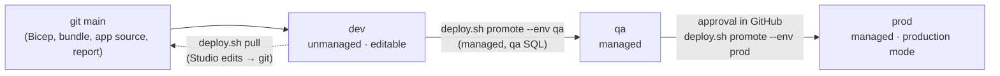

# Environments and release: dev, qa, prod

**This project deploys dev only.** qa and prod are fully defined (config, parameters, bundle targets, solution
promotion, CI jobs, GitHub environments with an approval on prod) so promotion is a configuration step, not a
rewrite. Nothing in qa or prod is built, so they cost nothing.

## What differs per environment

| | dev | qa | prod |
| :--- | :--- | :--- | :--- |
| Purpose | Build and demo | Pre-release checks | Real documents |
| Data | Synthetic | Synthetic + masked samples | Real (records rules apply) |
| Azure resource group | `rg-insurance-docai-dev` | `rg-insurance-docai-qa` | `rg-insurance-docai-prod` |
| Log Analytics | 30 days, 0.1 GB/day cap | 30 days, 0.5 GB/day | 90 days, 5 GB/day |
| Review app (Power Apps) | **Unmanaged** solution, editable in Studio | **Managed** solution, promoted from dev | Managed, promoted from dev |
| Power BI workspace | `insurance-docai` | `insurance-docai-qa` | `insurance-docai-prod` |
| Databricks | Free Edition (`-t free`), serverless | Azure workspace, catalog `docai_qa`, job clusters | Azure workspace, catalog `docai_prod`, **production mode**, runs as a service principal, group permissions |
| CI deploy | Manual or on demand | Manual | Manual **+ required approval**, `main` branch only |

Where each setting lives:

| File | Holds |
| :--- | :--- |
| `config/<env>.env` | Names and policies: resource group, Power BI workspace, Databricks target, solution type, CLI profile, data policy (committed, no secrets) |
| `infra/params/<env>.bicepparam` | Infrastructure sizing: SKUs, retention, ingestion cap, regions (committed). Identity values come from the shell or CI (`OPERATOR_OBJECT_ID`, `SQL_ADMIN_LOGIN`, `SQL_CLIENT_IPS`) |
| `.env.<env>` | Endpoints written by `infra/up.sh <env>` / `infra/env.sh <env>` (gitignored) |
| `databricks/databricks.yml` | Bundle targets `free` (dev), `qa`, `prod` |
| GitHub environments `dev` / `qa` / `prod` | Per-environment variables (IDs, URLs) and protection rules |

Every Python script reads its settings through `common.load_env()`, which loads `config/$DOCAI_ENV.env` and
`.env.$DOCAI_ENV` and never mixes two environments.

## Promotion flow



## Commands (laptop)

```bash
infra/up.sh dev                         # deploy dev (what this project uses)
infra/up.sh qa --what-if                # what would qa create? (deploys nothing)
infra/env.sh dev                        # rewrite .env.dev from the existing deployment
DOCAI_ENV=qa .venv/bin/python src/publish_powerbi.py      # any script, against another environment
databricks bundle validate -t qa        # bundle target per environment
powerapps/deploy.sh push                # dev: git → app (unmanaged)
powerapps/deploy.sh promote --env qa --dry-run            # build the managed qa solution, import nothing
infra/down.sh qa                        # tear an environment down (type its name to confirm)
```

Tested on 2026-11-06: `up.sh dev --what-if` showed no real changes against the running dev (the new parameter
files reproduce it); `up.sh qa --what-if` reports the resource group doesn't exist; `promote --env qa --dry-run`
built a solution flagged **Managed** whose app points at qa's SQL server; `push --env qa` is refused.

## CI/CD (GitHub Actions)

- `ci.yml` (every push and PR): unit tests, `actionlint`, Bicep build + all three parameter files, tag check,
  lakehouse tests on local Spark.
- `deploy.yml` (manual, plus a what-if on PRs that touch infra/config/bundle/app): `infra` → `lakehouse` →
  `review_app` → `reporting`, each job bound to the GitHub environment, so prod waits for an approval.
  **Off by default:** every deploy job is skipped until the repository variable `DEPLOY_ENABLED` is `true`.

### Turn on CI deploys (per environment; dev first)

1. **Entra app registration** for GitHub (one per environment, or one with several credentials):
   ```bash
   az ad app create --display-name gh-insurance-docai-dev
   az ad sp create --id <appId>
   az ad app federated-credential create --id <appId> --parameters '{
     "name": "github-dev", "issuer": "https://token.actions.githubusercontent.com",
     "subject": "repo:godot107/insurance-docai:environment:dev", "audiences": ["api://AzureADTokenExchange"]}'
   ```
   Add a second credential with subject `repo:godot107/insurance-docai:pull_request` for PR what-ifs.
2. **Azure roles** on the environment's resource group: *Contributor*, plus *Role Based Access Control
   Administrator* (constrained to the data-plane roles in `main.bicep`) because the template assigns roles.
3. **Azure SQL**: create the service principal as a database user (`CREATE USER [gh-insurance-docai-dev] FROM
   EXTERNAL PROVIDER`) with `db_ddladmin`, `db_datareader`, `db_datawriter` for the reporting job.
4. **Power Platform**: add the app as an *application user* with System Administrator in the environment
   (`pac admin create-service-principal`, or the admin center); the job signs in with `--githubFederated`.
5. **Power BI**: tenant setting *Service principals can use Fabric APIs*; add the app to the workspace as Member.
6. **Databricks** (Azure targets): a service principal with a GitHub federation policy; `DATABRICKS_CLIENT_ID`.
7. **GitHub variables** (no secrets needed): repository `DEPLOY_ENABLED=true`, `AZURE_TENANT_ID`,
   `AZURE_SUBSCRIPTION_ID`, `PP_DEV_ENVIRONMENT_URL`; per environment `AZURE_CLIENT_ID`, `OPERATOR_OBJECT_ID`,
   `SQL_ADMIN_LOGIN`, `PP_CLIENT_ID`, `PP_ENVIRONMENT_URL`, `DATABRICKS_HOST`, `DATABRICKS_CLIENT_ID`.
8. Run **Actions → deploy → Run workflow** with *what_if* on first, then off.

Not done for this project on purpose: steps 1-7 create identities and grant roles in the tenant, and qa/prod
would roughly triple the Azure footprint. The mechanism is in place; enabling it is the checklist above.

## Constraints of this subscription

- Free trial: Azure Databricks can't attach Unity Catalog without pay-as-you-go, so qa/prod Databricks targets
  point at placeholder hosts; dev uses Databricks Free Edition.
- Power Apps Developer Plan: up to 3 developer environments, enough for dev/qa/prod demos; production use needs
  premium licenses and a production environment type.
- SQL free offer: up to 10 free databases per subscription, so qa could use one too.
