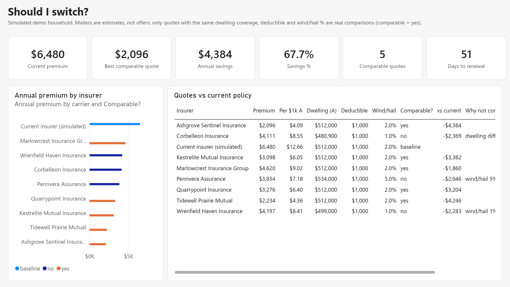
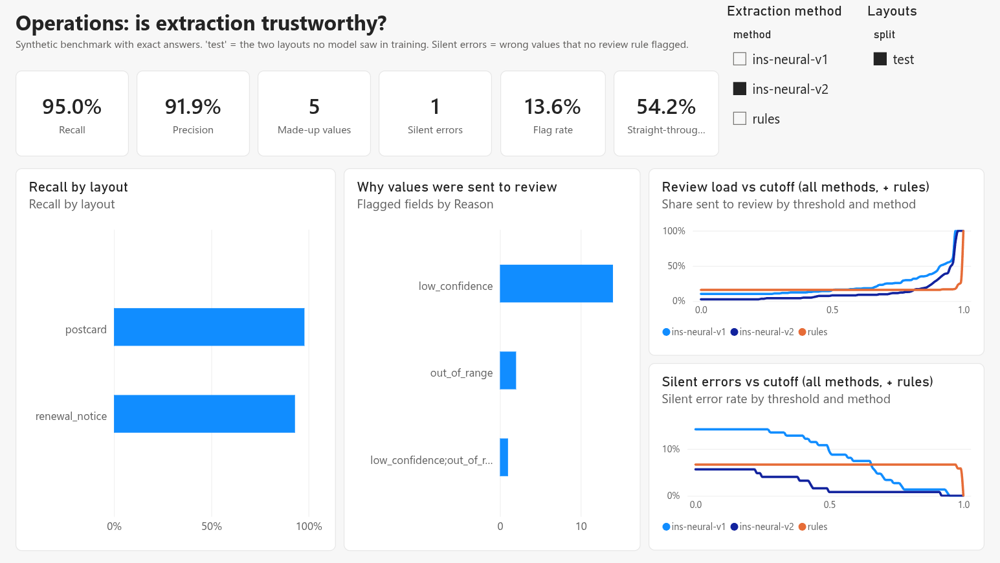
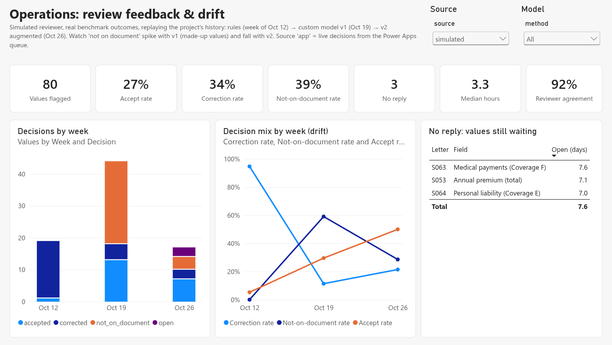
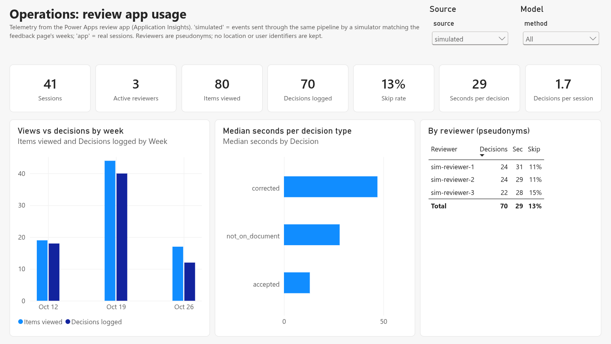
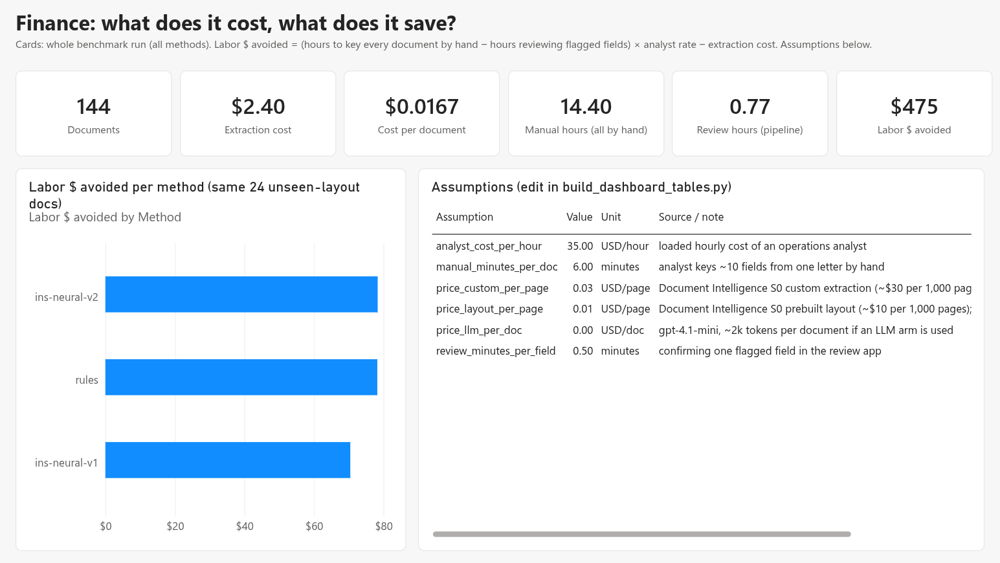

# Nine insurers mailed me a price for my house

## The problem

My homeowners renewal arrived at about **$7,200 a year**. Over the same months, nine other insurers had mailed
me "personalized quotes" for the same house, priced between roughly **$1,000 and $3,000**.

That looks like an easy decision. It isn't, because no two letters are alike. One calls it "Dwelling
Protection", another "Dwelling Coverage"; one prints a wind/hail deductible, eight don't; one quotes $440k
of coverage, another $529k; two had my square footage wrong. Comparing them means reading every letter,
pulling out the same dozen numbers, and noticing which ones can't actually be compared.

That's a small version of a common problem in government and financial services: an organization receives
piles of documents in inconsistent formats and needs structured data it can trust, with a person in the
loop where the machine is unsure. A state insurance regulator reviewing rate increases, or a benefits
office processing applications, faces the same thing at larger scale.

## What I built

A pipeline on Microsoft Azure that:

1. **Reads the documents** with Azure AI Document Intelligence (scans and digital PDFs).
2. **Maps every carrier's wording to one standard schema**: coverages A–F, premium, deductibles, property facts.
3. **Checks each value**: confidence score, plausible range, and ratios (contents coverage is usually 25–75% of
   dwelling coverage, for example). Anything suspicious goes to a person.
4. **Removes personal information** in three layers before anything is shared.
5. **Compares quotes against the current policy**, and says which are actually comparable and why not.
6. **Serves the results** through Azure SQL to a Power BI dashboard with pages for the homeowner, operations,
   and finance, and through a Databricks lakehouse (Unity Catalog bronze/silver/gold, MLflow) for analysis.

Everything is infrastructure-as-code (Bicep), uses no passwords or API keys (Microsoft Entra ID only),
is tagged for cost tracking, and costs about nothing while idle.

## Testing it honestly

Ten real letters can't tell you how accurate a system is. So I generated **96 synthetic letters** from 8
fictional insurers in 6 different layouts, about half degraded to look like cheap scans. Because I created
them, I know every correct value exactly. Two layouts (a postcard and a renewal notice) were held out
completely: no model or rule saw them before testing. The real question for any document system is how it
does on the format nobody planned for.

### Result 1: The confidence score can lie

Hand-written rules on top of Document Intelligence's general-purpose layout model got **96% of fields right
on familiar layouts but only 78% on the unfamiliar ones**. Worse, the wrong values came with the same
confidence (≈0.99) as the right ones. The score measures "I read these characters correctly", not "this
number belongs in this field". A policy of "send low confidence to a human" would have passed every error.
Range and ratio checks caught 70% of them; the rest were **silent errors**.

### Result 2: A custom model generalizes, and knows when it's unsure

I trained a custom neural extraction model on 72 labeled synthetic letters (labels generated automatically
in Document Intelligence's own format). On the unseen layouts:

| | Rules | Custom model |
| :--- | :--- | :--- |
| Printed fields extracted correctly | 78% | **93%** |
| Wrong values | 27 | 6 |
| Errors caught by the review step | 70% | **95%** |
| Silent errors | 8 | **2** |

Its weakness is new: it sometimes fills in a field the document doesn't print. But it does so at low
confidence, and its confidence is genuinely calibrated: values scored above 0.95 were 100% correct, values
below 0.8 about 30%.

### Result 3: Choosing the review threshold from data

Every threshold trades human workload against errors that slip through. With the custom model, a cutoff of
**0.78 plus the schema checks sends about 30% of values to a person and lets 1.4% of errors through**.
With the rules, the only way under 2% is to review everything. (Both cutoffs were chosen on the test letters; Result 3b checks them honestly.)

### Result 3b: Training on "bad" documents fixed the model's main weakness

I generated 150 deliberately difficult training letters: fields left off the page, misleading extra numbers
("last term you paid…"), labels above values instead of beside them, and harsh scans (fax-style black and
white, phone-photo angles, upside-down pages). On the same unseen test layouts, the retrained model:

| | Before | After augmentation |
| :--- | :--- | :--- |
| Made-up values | 30 | **5** |
| Precision | 76% | **92%** |
| Values a person must check (≤2% silent errors, cutoff chosen on the test letters) | 30% | 6.5% (optimistic, see below) |

That last row was chosen and measured on the same letters, so I checked it honestly: pick the cutoff on one
unseen layout, apply it to the other. It doesn't hold. On the easy postcard layout the model barely erred, so
the chosen cutoff was "review almost nothing", and on the harder renewal notice that let **9% of values
through wrong**. Cutoffs don't transfer between layouts. The fix is operational, not statistical: when a new
layout shows up, a person reviews its first few documents in full, the cutoff for that layout is set from
those reviews, and only then does the system route by confidence. Until then, a conservative cutoff (about
half the values reviewed for v2, no silent errors on either test layout) is the safe default.

Augmentation still cut made-up values six-fold and lifted precision from 76% to 92%. One more lesson: a third of the harshest scans had at least one
number that OCR could not read at all. No model fixes that, so a production intake needs a "please rescan"
check before extraction, not just a review step after it.

### Result 4: It transfers to real mail

On my real letters (provisional, labels being confirmed), the synthetic-trained custom model extracted
**about 97% of printed fields correctly, with no silent errors**, at the cost of more fields flagged for review.

### Result 4b: A smarter router isn't automatically better

On Databricks I trained a model to predict which extracted values are wrong (using confidence, rule hits,
layout and scan type) and tested it on insurers it had never seen. It ranked errors far better than raw OCR
confidence (AUC 0.91 vs 0.53), yet at the same review budget it didn't beat a calibrated threshold plus simple
validity rules. With eight insurers, the simple policy wins. I kept the router as a ranking aid to re-test
once real review decisions accumulate. Negative results are results.

### Result 4c: Reviewer decisions are a drift monitor

Every decision in the review app is stored with who made it and when, so the review queue doubles as a model
monitor that needs no extra labels. Replaying this project's own history (rules, then the first custom model,
then the augmented one) through a simulated reviewer on the real benchmark outcomes, the decision mix tells
the story by itself: under rules, 95% of flagged values needed **correcting**; when the first custom model went
live, the share marked **"not on the document"** jumped from 0% to 59% (it was making values up); after
augmentation it fell to 29% and half of flagged values were simply **accepted**. In production that spike is the
alert that triggers retraining, and "no reply" aging shows when the review team is falling behind.

The app also reports its own usage: each view and decision is a telemetry event in Azure Application Insights
(time spent per item, items opened but skipped), with reviewers reduced to pseudonyms. Corrections take about
three times as long as accepting a value, which turns "make the model better" into a staffing number. Because
real usage takes weeks to accumulate, a simulator sends matching events through the same pipeline, labelled as
simulated, so the whole path from app to dashboard is exercised end to end.

### Result 5: Generic privacy tools miss domain IDs

Azure AI Language (the counterpart of AWS Comprehend's PII detection) found names, addresses and phone numbers,
but missed insurer-specific identifiers like policy and mortgage loan numbers. A generic rule ("whatever
follows 'Policy Number' or 'Loan #'") caught all but one; a short list of known identifiers caught the rest.

## The dashboard

One Power BI report, three audiences, built entirely as code from Linux (no Power BI Desktop): the semantic
model is pushed through the REST API and the report pages are generated as PBIR JSON and published with the
Fabric API. The household page uses a simulated household.

## What I'd tell a client

- **Measure on the layouts you didn't design for.** In-distribution accuracy (96%) hid the real number (78%).
- **Don't route on raw OCR confidence.** Calibrate first; it may carry no signal at all.
- **Count silent errors, not just accuracy.** Wrong-and-unflagged values are what end up in a report.
- **Design the human review step with numbers**: workload vs. risk, chosen deliberately.
- **Validate the threshold on a layout it wasn't chosen on.** Mine looked like 6.5% review; honestly measured,
  a new layout needs a burn-in review before any cutoff can be trusted.
- **Privacy needs domain rules** on top of generic PII models.

## For homeowners

Mailers are estimates, not offers. Before comparing prices, match the dwelling coverage, the deductible
**and the wind/hail percentage**, and ask how the roof is paid on a claim. Get binding quotes on the same terms,
switch on the renewal date, and repeat every year.

## Stack

Azure AI Document Intelligence (prebuilt layout + custom neural), Azure AI Language (PII), Databricks (Unity Catalog, Delta, MLflow), Power Apps (review queue, managed as code with the Power Platform CLI), Azure AI Foundry
(gpt-4.1-mini for synthetic wording), Blob Storage (Parquet), Azure SQL Database, Power BI, Log Analytics,
Bicep, Python, GitHub Actions.

<!-- TODO before publishing: confirmed real-letter labels; round all personal figures; PII audit per docs/PRIVACY.md. -->
